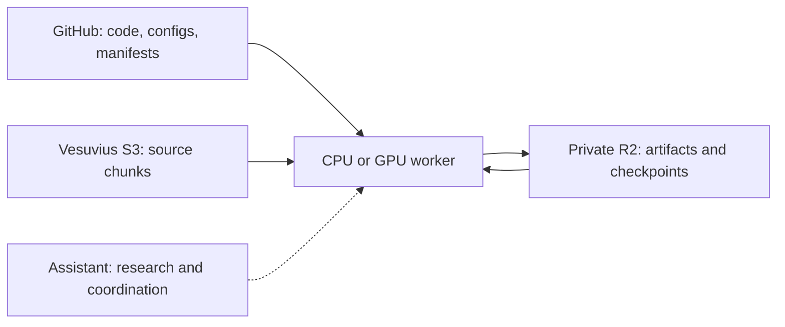

# Research infrastructure

Workers run saved experiment specifications. Bulk data does not pass through the assistant. Git stores source and compact definitions; private object storage preserves large evidence. Fast worker-local disk stages a bounded input set and active outputs.

This first increment implements independently usable cache and artifact commands, preserves the verified CPU detector and defines a blocked native reference/GPU pilot specification. It does not yet orchestrate complete cloud jobs or replace the historical lab's geometry and crop-selection pipeline.

The encoded cache serializes acquisition with a POSIX lock. Decoded arrays and training prefetch require their own memory/staging limits. Completed objects survive interruption; a failed object's partial transfer restarts. Preserve input hashes/ETags in the experiment manifest, since unpinned cache entries can be evicted.

Artifact publication freezes a run plan, verifies stored bytes and publishes its completion manifest last. A partial run remains incomplete and can resume with the exact same files and metadata. R2 is an object store, not a training filesystem; its active artifacts should use Standard storage initially. Its single-PUT implementation has a conservative 5 GB artifact cap.

Use a measured workload to select GPU hardware. A worker requires a separate CUDA environment, bounded cost and independent provider shutdown. The approved first pilot cap is £10 total, including retries. Infrastructure cannot supply missing supervision, scan resolution or specialist reading evidence.

See [local validation](validation.md), [cache](cache.md), [artifact storage](artifacts.md), [GPU policy](gpu-pilot.md) and [scientific reference](reference-experiment.md).
