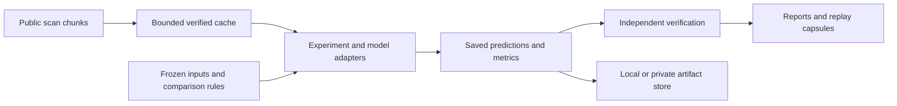

# A tour of Herculaneum

[Overview](../README.md) · [Run the demo](quickstart.md) · [Roadmap](roadmap.md)

Herculaneum is a personal research software project investigating ink detection and surface geometry in CT scans of carbonised papyrus. Its engineering work makes experiments bounded, inspectable and recoverable. This tour highlights a few decisions a technical reviewer can follow from the claim to the implementation and evidence.

## How the pieces fit

Git holds code, configurations and selected evidence. Large data and model weights have separate storage. Some research tasks still use historical lab scripts: the CLI is working infrastructure, not an end-to-end cloud experiment orchestrator.

## 1. Make data failure explicit

A scan is too large to treat every experiment as a full download. The [chunk cache](../src/herculaneum/chunk_cache.py) bounds object size and total encoded storage, checks hashes on reuse, and protects active inputs with persistent owner pins.

An important distinction is an absent object versus a failed request. Only a bounded S3-style `NoSuchKey` response becomes a missing-chunk result. A timeout, access error or generic 404 remains a failure. This prevents transport problems from silently becoming empty scientific data.

Read the [cache contract](cache.md) and [failure/recovery tests](../tests/test_chunk_cache.py). The implementation uses a POSIX lock and atomic filesystem operations; it does not yet provide parallel acquisition or a decoded-array memory budget.

## 2. Define what “saved successfully” means

The [artifact store](../src/herculaneum/artifacts.py) freezes a run plan, writes outputs without overwriting existing objects, reads them back, and writes the completion manifest last. Retrying identical inputs can resume an interrupted publication; changed inputs require a different run identity.

This makes incomplete work distinguishable from verified results. Local and R2 stores share the publication contract. The [tests](../tests/test_artifacts.py) exercise corruption, collisions, interruption and credential isolation using local files and a fake cloud client. [Recorded live checks](validation.md) have a separate scope.

Try the [offline demo](quickstart.md#offline-artifact-demo) to see the actual implementation accept a saved result and reject corruption.

## 3. Treat reproducibility as a checkable result

[Experiment 46](https://github.com/jl-drx/Herculaneum/blob/9f6fe45ab20eb0961d5e06aba5c3038088941180/research/lab/reports/fortysixth-experiment/RESULTS.md) reproduces a published PHerc343 display using the fixed four-model recipe. The composite has RGB mean absolute error 0.0181/255 and yellow-display IoU 99.83%.

Those numbers answer “did this implementation reproduce the published image?” They do not answer “which pixels contain ink?” The report retains runtime differences, unavailable author raw maps and the distinction between visual agreement and independent ground truth.

## 4. Use a failed check to improve the implementation

In [experiment 47](https://github.com/jl-drx/Herculaneum/blob/9f6fe45ab20eb0961d5e06aba5c3038088941180/research/lab/reports/fortyseventh-experiment/RESULTS.md), a recorder applied an in-place sigmoid to live logits. The inference loop subsequently applied sigmoid again, changing the baseline.

The exact-baseline gate caught the mismatch and stopped shifted inference. The corrected recorder used a detached clone; all 262,144 saved baseline pixels then matched exactly. Three predetermined shifts were evaluated once, with top-10% response Dice of 0.480–0.626 against the original grid.

This established sensitivity to grid placement in that region. It did not identify the correct prediction or justify selecting the best-looking phase. The failed attempt and corrected evidence remain available.

## 5. Let someone else replay the decision

[Experiment 39](https://github.com/jl-drx/Herculaneum/blob/9f6fe45ab20eb0961d5e06aba5c3038088941180/research/lab/reports/thirtyninth-experiment/RESULTS.md) compares a fixed prediction midpoint with retained controls. The midpoint failed the predefined improvement criterion, and the baseline was retained.

Its [capsule descriptor](https://github.com/jl-drx/Herculaneum/blob/9f6fe45ab20eb0961d5e06aba5c3038088941180/research/CAPSULE.json) identifies 93 files in a 12,266,312-byte archive. The [replay tool](https://github.com/jl-drx/Herculaneum/blob/9f6fe45ab20eb0961d5e06aba5c3038088941180/research/tools/replay_phase39.py) verifies the archive and members, reconstructs the comparison, checks the metrics and compares the decision payload with the retained result. This is saved-output replay, not model training or fresh inference.

The [quickstart](quickstart.md#replay-a-real-experiment) gives the pinned checkout and commands. [Historical portability validation](https://github.com/jl-drx/Herculaneum/blob/9f6fe45ab20eb0961d5e06aba5c3038088941180/research/PORTABILITY_VALIDATION.json) records a relocated environment on the same machine; it is not evidence of a separate physical-machine replication.

## AI-assisted development and evaluation

The project includes AI-assisted implementation and review. Useful review evidence comes from executable checks and retained outcomes. For example, the recorder failure above provides a concrete case for comparing suggested fixes: preserve the model's tensors, reproduce the original baseline, and explain the failure mechanism.

Future coding-assistant comparisons can use the [bounded engineering tasks](roadmap.md), with fixed input fixtures and acceptance criteria. A useful evaluation records correctness, regressions, reproducibility, resource use and the reasoning behind a change. These are proposed evaluation tasks, not claims of completed commercial work.

## Scope and credit

James Lee's personal project builds on Vesuvius Challenge data, published models and other upstream research. It does not claim those underlying models or datasets as original inventions. Retained notices and per-asset terms apply, including noncommercial terms on some research data and derivative figures.

The evidence links in this tour are pinned to research snapshot `9f6fe45`. For ongoing priorities, consult the [research plan](https://github.com/jl-drx/Herculaneum/blob/9f6fe45ab20eb0961d5e06aba5c3038088941180/research/CURRENT_PLAN.md); historical “next step” sections record decisions made at that time.
