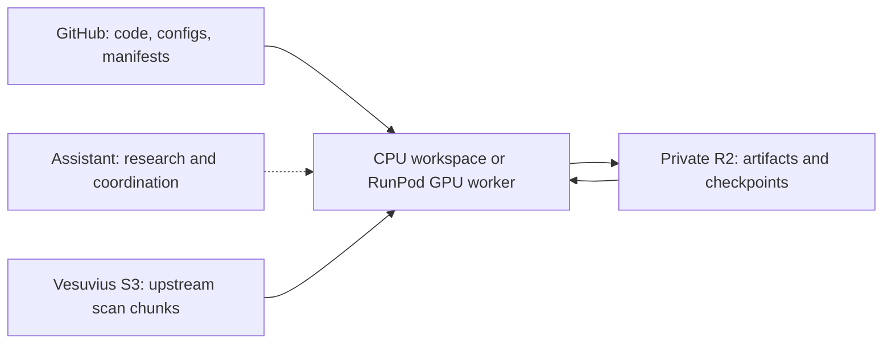

# Proposed research infrastructure

Prepared 8 October 2026 for review. This is a design, not a deployed R2 or RunPod service. Astra independently reviewed the architecture and scientific gates. No paid compute, new buckets or GitHub publication was performed.

The user's proposed services are a sensible fit. Reproducible workers should execute the work; the assistant coordinates research and development. GitHub describes experiments, Vesuvius supplies upstream observations, private R2 preserves artifacts, and disposable CPU/GPU workers execute a frozen experiment specification.

## What exists now

- The local lab is approximately 1.2 GiB; its Python environment is approximately 1.5 GiB. The 32 GiB workspace filesystem reports approximately 28 GiB available. These are different measurements: directory sizes are not a sum of additional writable-layer consumption.
- The GitHub remote exists, but the checkout has no commits. Lab scripts, experiments and reports currently live outside the checkout under `/workspace/herculaneum-lab`. GitHub is not yet preserving that work.
- Acquisition reads only selected Zarr objects using HTTPS. These are actual CT or scan-derived surface-volume intensity chunks, not replacement thumbnail images. Native CT chunks are 128 cubed uint8 voxels; the selected surface stack uses 31 by 128 by 128 uint8 chunks.
- A bounded crop is downloaded and staged locally before inference. Four acquisition threads are used. HTTP reads stream into bounded buffers, but the current large-crop adapter collects its batch before writing; it is not a lazy training data loader or an evicting cache. Both raw objects and assembled arrays are retained.
- Inference reads the staged array through a memory map. The largest target crop, 1536 by 1536, scored 523 tiles per checkpoint: 95.17 and 84.28 seconds of model inference on four CPU threads. Acquisition, model loading and analysis are additional work.
- There is no configured R2 persistence or RunPod worker. The current dependency lock and model adapters are CPU-oriented; a CUDA environment must be separately pinned and verified. Running the existing setup script on a GPU host would synchronize CPU PyTorch wheels; moving these scripts onto a GPU host alone does not enable CUDA execution.

## Service responsibilities

| Component | Store or execute | Boundary |
| --- | --- | --- |
| GitHub | Source, dependency and image specifications, experiment configurations, input/artifact manifests, compact metrics and review documents | Keep scan arrays, checkpoint binaries and large rendered reports out of Git history. Git LFS is not the default bulk artifact store. Preserve third-party licenses and source provenance. |
| Vesuvius S3 | Authoritative public observations, geometry and metadata | Fetch only the required objects. Reads occur in workers, without routing bulk data through the assistant. A slice still incurs the source chunk's download/decode cost. |
| Local worker disk | Encoded chunk cache, bounded decoded staging, model files and active checkpoints | Disposable fast workspace, not the only copy of accepted evidence. Training should reuse staged data across epochs. |
| Private R2 | Derived predictions, selected evidence crops, full reports, logs, metrics, resumable checkpoints and immutable run manifests | Object storage, not a POSIX training filesystem. Preserve exact input bytes needed for reproducibility when permitted; do not blindly mirror the public corpus. |
| RunPod GPU | A specified training/inference/benchmark job in a pinned image | Disposable compute. Runtime, resource limits, checkpointing and lifecycle must be managed independently of the chat. |
| Assistant and user | Research decisions, development, interpretation and review | Every acquisition, transformation and job should be executable from the saved specification. Human specialist review remains necessary for reading claims. |

## Bounded data access

The first infrastructure improvement should be a shared, resumable chunk cache, not a general distributed streaming platform.

1. Identify an array by its upstream URL and metadata hash. Index its objects by chunk key and source version/validator, then store verified payloads by SHA-256. ETags are source validators, not universally content checksums.
2. Derived cache identity additionally includes geometry, render transform, depth orientation, interpolation, crop and preprocessing versions. An XYZ index alone is insufficient.
3. Bound encoded disk cache, decoded staging and in-flight request/decompression memory separately. Proposed initial CPU-workspace limits are 8 GiB encoded cache, 4 GiB derived staging, four requests, and an 8 GiB minimum free-disk reserve; these remain configurable and require accounting for model files and temporary output. Check actual free space before work and uploads.
4. Prefetch chunk-aligned regions, reuse overlapping inputs and retain them across epochs. Do not issue a fresh S3 request for every patch. Stage the frozen experiment's bounded input set on local SSD when practical.
5. Resume verified chunks after interruption. Evict reconstructible, unpinned inputs only after required run evidence is durably preserved. Do not automatically delete existing historical experiments.
6. Preserve the existing distinction between explicit missing Zarr objects using declared fill values and HTTP failures, authentication errors, timeouts or corruption. Missing-fill records are part of the input manifest.

Private R2 is the appropriate home for our derived artifacts and selected frozen evidence, subject to the relevant asset terms. Source links plus hashes do not guarantee future byte-for-byte reproducibility if upstream objects change or disappear. This is why important permitted input evidence may need retention, while ordinary reconstructible chunks can be evicted.

## One job contract

**Frozen input manifest + code/image identity + experiment configuration + resource/budget limits → checksummed artifacts + metrics + provenance + explicit completion status.**

Before launch, the specification must identify:

- Code commit and image digest; dependency lock; model configuration and checkpoint SHA-256.
- Upstream metadata and chunk identities, geometry/render lineage, data selection and physical evaluation regions; annotation and pseudo-label lineage.
- Exact preprocessing, depth/orientation, masks, output alignment, seeds, precision mode and batch size.
- CPU/RAM/GPU requirements, disk and acquisition caps, wall-time limit, expected transfer volume and approved spend limit.
- Private artifact destination, checkpoint interval and explicit completion/failed/interrupted behavior.

Each result manifest should record actual hardware, environment and configuration hashes, source bytes/validators, tile counts, runtime, peak memory, transfer/decode time, cache misses, metric definitions and artifact checksums. A GPU port needs a bounded numerical comparison against the CPU baseline; mixed precision is a declared change and should be checked for its scientific effect.

Write artifacts to unique immutable run keys, verify SHA-256 values, and upload a completion manifest last. R2's current S3 compatibility table does not implement AWS bucket-versioning APIs, so immutability must come from object keys and manifests rather than an assumed versioning feature. Do not treat a partial directory, an ETag or an interrupted multipart upload as proof of a complete run. Upload checkpoints atomically as complete objects before updating the reference to the newest verified checkpoint. Resume requires matching code/config/input identities and optimizer, scheduler, scaler and RNG state when applicable.

Use runtime-injected, narrowly scoped credentials. Do not commit credentials, signed URLs or secret-bearing environment dumps. Infrastructure account secrets are not needed for this design review.

## GPU and scientific gates

1. **Freeze the native reference recipe.** Audit the released PHerc1667 iteration-0/5 ablation weights, source geometry, original depth sampling, normalization, output alignment and training lineage. Select bounded reference regions before observing predictions.
2. **Reproduce known signal.** Compare iteration 0 and 5 on the paper's `l_5` inference column and retain source-linked review panels. `l_5` is held out from `l_2` adaptation, not necessarily every earlier training or selection decision. Supplementary Table 2 lists it as inference-only without labels: visibility/reproducibility can be assessed, but numerical held-out accuracy requires independently obtained annotations. Repeated inspection for model selection makes it a development set. A labeled `l_2` check is training-overlapped.
3. **Measure the actual bottleneck.** Start with bounded CPU work where practical. If the faithful native model or a frozen larger workload requires acceleration, benchmark representative acquisition, decoding and inference/training on a fitting GPU. Record throughput, host RAM, peak VRAM, total runtime and total cost, including storage and idle time. Do not promise a particular card's capacity from input dimensions alone.
4. **Select hardware from measurements.** Use a smaller available GPU when it fits the unchanged scientific recipe with headroom and has better total cost. An H100 is justified by measured memory requirements, throughput or a deadline. A fixed, short benchmark and explicit cost cap should precede a long training run.
5. **Validate target transfer separately.** Native approximately 2.4 micrometre PHerc1667 reproduction does not establish transfer to eligible 8.64 micrometre PHerc0800. The existing 9 micrometre model remains the initial target baseline. Target adaptation needs a conservative independently reviewed seed signal and physically separate validation support, not today's diffuse detector responses.
6. **Require source-supported reading evidence.** Consistent strokes, correct surface placement, repeated-rendering support and independent specialist readings precede transcription or translation. A documented null result is an acceptable experiment outcome.

The proposed default is therefore to continue development and current small experiments on CPU, prepare the native reference specification, and use a short bounded GPU benchmark only when that recipe demonstrates a compute need. No H100 purchase or reservation follows from the architecture proposal.

## Persistence and operational costs

Prefer R2 Standard for active artifacts and checkpoints. Direct R2 egress is free under its current pricing, but storage and API requests are billable; Infrequent Access has retrieval charges and a minimum retention period. Avoid writing checkpoints so frequently that requests, uploads and synchronization dominate useful training time.

For repeatable batch research, a GPU Pod with staged local data is a straightforward starting point. Do not assume RunPod Serverless cold starts, model caching and billing match a Pod. Pod compute remains billable while the Pod is running even after the Python program exits. Stopped disks may remain billable; terminating a Pod destroys its Pod-local storage. Ensure final evidence is verified in R2 before termination and make budget/time enforcement independent of a successful Python exit. If both object-store access and checkpoint upload fail, keep the job in an explicit recoverable failure state rather than silently claiming success.

Official references: [R2 pricing](https://developers.cloudflare.com/r2/pricing/), [R2 S3 API](https://developers.cloudflare.com/r2/api/s3/api/), [RunPod storage types](https://docs.runpod.io/pods/storage/types), [RunPod Pod management](https://docs.runpod.io/pods/manage-pods), [June PHerc1667 paper](https://arxiv.org/html/2606.29085v1), and our [methods audit](../methods-review/PHERC1667_METHODS.md).

The [storage implementation audit](storage-audit.md) records inspected code and measured footprints. The [provider source audit](source-audit.md) records current official pricing/lifecycle details, verified documentation links and the unresolved discrepancy in Serverless disk billing. Neither audit estimates unmeasured GPU speed or commits to a lease price.

## Next implementation increment

Prepare a small versioned project from the reusable lab scripts, pinned environments, provenance manifests and compact documentation; exclude data, credentials and large generated outputs. That package can be reviewed before GitHub publication. Then add the bounded cache and R2 artifact contract, test an interrupted/resumed transfer and checksum verification, and finally prepare a CUDA worker image and bounded benchmark specification. Implement only what the next frozen experiment needs.

This review adds design artifacts outside the selected repository, consistent with the ongoing onboarding workflow. The empty checkout remains unchanged.
