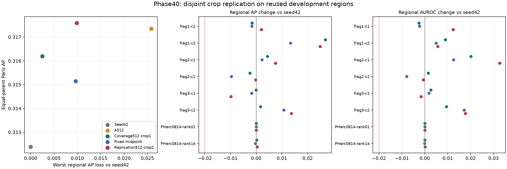

# Phase40: disjoint source-crop replication

Advancement: **FAIL**. Descriptive replication of the midpoint tradeoff: **FAIL**. See [next study recommendation](NEXT_STUDY_DRAFT.md) for the resulting research decision. No GPU resources were used or authorized by these results.

Crop2 has the highest Paris AP of the five fixed states, but its gain over A512 is only 0.000247059. Both mixed runs pass the regional retention floor that A512 breaches. The stricter midpoint relation misses only worst AP retention, by 0.000206010, with the worst region shifting from frag2-context2 (midpoint) to frag3-context1 (crop2). This is a narrow descriptive miss, not evidence that broader training data generally fails. The original-source exposure confound remains.

The frozen 512-update mixed recipe was run once from original seed42, substituting PHerc1667/w013 crop [2560,640,256,256] for crop1 [3968,1408,256,256]. Source rectangles have X/Y gaps of 1152/512 level-2 pixels. This is a spatial replication within one supplied surface coordinate system, not a different surface/scroll, an untouched test or independently verified physical mesh separation.

## Fixed endpoint

| Role | Paris AP | Paris AUROC | Worst regional AP delta | Worst regional AUROC delta |
| --- | ---: | ---: | ---: | ---: |
| Seed42 | 0.312384168 | 0.721214951 | +0.000000000 | +0.000000000 |
| A512 | 0.317344041 | 0.732029923 | -0.025821085 | -0.018205357 |
| Coverage512 crop1 | 0.316197413 | 0.727732786 | -0.002464336 | -0.002522211 |
| Fixed midpoint | 0.315146551 | 0.726847859 | -0.009638093 | -0.007936155 |
| Replication512 crop2 | 0.317591101 | 0.731491882 | -0.009844102 | -0.001655866 |

Paris summaries average regions within each parent and weight Paris1/Paris2 equally. Worst deltas are the minima across all eight regions against seed42; PHerc0814 contributes to retention, not Paris aggregation. Crop2 Paris AP gain is +0.005206933 against seed42 and +0.000247059 against A512. Advancement requires both >=0.01 and no region below -0.02 in AP or AUROC.

Frozen descriptive components against the single midpoint: Paris AP no lower = True; worst AP delta no lower = False; worst AUROC delta no lower = True. All three are required. This relation does not replace advancement.

Regional advancement failures: `[]`.

### Regional AP deltas for crop2

| Region | vs seed42 | vs A512 | vs crop1 | vs midpoint |
| --- | ---: | ---: | ---: | ---: |
| frag1-context1 | +0.002011064 | +0.005813072 | +0.003621977 | +0.003751793 |
| frag1-context2 | +0.024806443 | +0.002319157 | -0.002121563 | +0.011498203 |
| frag2-context1 | +0.007500010 | +0.002300590 | +0.003100997 | +0.005296815 |
| frag2-context2 | -0.000220381 | +0.025600704 | +0.002243955 | +0.009417711 |
| frag3-context1 | -0.009844102 | -0.006798640 | -0.009771349 | -0.008092783 |
| frag3-context2 | +0.013623265 | -0.010229884 | +0.011923417 | +0.002888720 |
| pherc0814-46527-fresh-rank01 | -0.000011782 | +0.000000923 | +0.000001593 | -0.000009320 |
| pherc0814-46527-fresh-rank14 | +0.000354603 | +0.001167153 | +0.000128324 | +0.000689375 |

### Regional AUROC deltas for crop2

| Region | vs seed42 | vs A512 | vs crop1 | vs midpoint |
| --- | ---: | ---: | ---: | ---: |
| frag1-context1 | +0.012380772 | +0.018430136 | +0.014902982 | +0.014695726 |
| frag1-context2 | +0.005614064 | -0.001839099 | -0.003356914 | +0.000698085 |
| frag2-context1 | +0.032628498 | +0.004542574 | +0.012501528 | +0.020066265 |
| frag2-context2 | -0.000594688 | +0.017610670 | -0.002127673 | +0.007341468 |
| frag3-context1 | -0.001655866 | -0.004848193 | -0.004288708 | -0.003422688 |
| frag3-context2 | +0.017749267 | -0.016676112 | +0.008365132 | +0.000598009 |
| pherc0814-46527-fresh-rank01 | -0.000007705 | +0.000000423 | +0.000001067 | -0.000006267 |
| pherc0814-46527-fresh-rank14 | +0.000074126 | +0.000141856 | +0.000009285 | +0.000100967 |

Full raw metrics, fixed 0.5/historical-cutoff confusion tables and aggregates for all five roles are in [METRICS.json](METRICS.json). No threshold or coefficient was fitted.

## Optimisation and source exposure

| Update | Fixed mixed objective | Hard-label BCE diagnostic | Seed42 KL |
| --- | ---: | ---: | ---: |
| 0 | 0.609827178 | 0.375462732 | 0.000000000 |
| 32 | 0.602994247 | 0.350308158 | 0.005148542 |
| 128 | 0.593838995 | 0.340434734 | 0.006806014 |
| 256 | 0.592638384 | 0.339271442 | 0.008077461 |
| 384 | 0.591584129 | 0.334903276 | 0.009161716 |
| 512 | 0.590907515 | 0.335399619 | 0.008808198 |

These risks compare checkpoints on the same fixed crop2 schedule. They are not cross-crop accuracy measures. The following final risks use the identical original PHerc0139 schedule for every arm:

| Model | Original-support objective | Hard-label BCE | Seed42 KL |
| --- | ---: | ---: | ---: |
| A512 | 0.583281090 | 0.306838395 | 0.006525980 |
| Crop1 | 0.585541631 | 0.312356710 | 0.005258589 |
| Crop2 | 0.585592092 | 0.313273516 | 0.005671180 |

All arms use the same .25/.75 BCE + unit seed42 KL recipe; crop1 and crop2 replace identical original patch slots. Every mixed update exactly matches A512's total positive/negative counts, with 230,340/387,868 visits per 32-step cycle. Original-source exposure is still half of A512's patch slots. Crop2 uses 46,020 unique additional supervised pixels versus crop1's 55,313, giving total unique training support 100,721 versus 110,014. This is not a pure diversity experiment or a control for unique support size/layout.

## Admission and validation

Stage1's eight predeclared candidates all failed class-count feasibility; no CT chunks or training followed that failure. A separately frozen stage2 expanded only the label inventory and admitted its first candidate. All 32 replacement requirements remained fixed. Total: 68 metadata/label/CT requests, 10,707,142 delivered bytes, four CT chunks. A separate reconstruction verified all eight rejected candidates, the expanded inventory ordering and the accepted candidate. This audit was added after training launch; selection rules and acquisition GOs existed before their corresponding label bodies and all model calls.

Seven pre-run fixtures passed, including exact historical objective/gradient parity across all 32 batches. Independent reconstruction checked the raw CT pooling, central labels, selected supports, crop/augmentation and normalization. All 32 retained PHerc0139 teacher patches matched the historical cache exactly.

One scientific attempt completed: 512 backward/update steps, 32 teacher batch-two forwards, 705 student batch-two forwards and 200 development tile forwards. Controller elapsed time 615.511 seconds; peak training RSS 1,625,739,264 bytes. Independent verification checked 768 training loss rows / 4608 scalar values (maximum discrepancy 1.22e-07), 80 ranking values (maximum discrepancy 1.11e-16), all eight masks and 1,179,648 score pixels / 200 sigmoid-Hann blended tiles (maximum discrepancy 2.84e-07). It recomputes retained scalar arithmetic, not autograd/optimizer trajectories. All aggregates, contrasts and decisions were independently checked. The prelaunch AST correction is recorded separately; no scientific retry occurred.

All evaluation contexts remain reused development. Supplied labels have incomplete human/teacher ancestry. Frag6 optical registration and physical depth remain unresolved; all original 17 input planes are retained. Reserved parents were untouched. No independent ink accuracy, readable text, transcription or translation has been established. The updated local R2 handoff still reports no Runpod secret import or worker injection; this study does not rely on it. CPU monetary spend is unrestricted, and the £10 total first GPU pilot cap remains in force with GPU work deferred.
