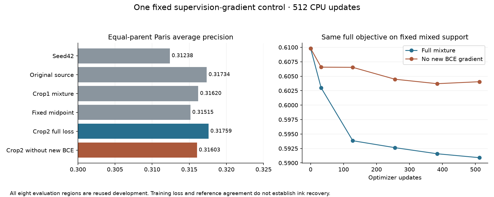

# Experiment41: contribution of the new crop's supervised loss

One frozen 512-update CPU control completed. **Advancement: False. Prespecified descriptive mechanism result: `tradeoff`.** The control keeps phase40's exact inputs, label-selected support and teacher KL, while removing only PHerc1667 crop2's BCE gradient. It is not a label-free control and does not remove the new crop's preservation term.

The new crop's supervision improves aggregate Paris AP by 0.001556856 and worst AUROC retention by 0.008139835 relative to this control, while worsening worst AP retention by 0.006896297. Neither arm dominates all three prespecified quantities. Both pass the regional floors and fail the material-gain screen. Keep seed42 as the baseline and move the main research effort to acquisition learnability; no GPU work is justified by this result.

## Fixed endpoint

| Role | Paris AP | Paris AUROC | Worst AP delta vs seed42 | Worst AUROC delta vs seed42 |
| --- | ---: | ---: | ---: | ---: |
| seed42 | 0.312384168 | 0.721214951 | +0.000000000 | +0.000000000 |
| A_control-512 | 0.317344041 | 0.732029923 | -0.025821085 | -0.018205357 |
| C_coverage-512 | 0.316197413 | 0.727732786 | -0.002464336 | -0.002522211 |
| midpoint | 0.315146551 | 0.726847859 | -0.009638093 | -0.007936155 |
| D_replication-512 | 0.317591101 | 0.731491882 | -0.009844102 | -0.001655866 |
| E_no_new_BCE-512 | 0.316034245 | 0.724259750 | -0.002947806 | -0.009795701 |

Control AP gains: +0.003650076 vs seed42 and -0.001309797 vs A512. Advancement requires both >=.01 and no region AP/AUROC drop below-.02. Regional failures: `[]`.

The control-minus-full-mixture contrasts are `{"Paris_AP": -0.0015568562762786065, "worst_AP": 0.0068962965462815995, "worst_AUROC": -0.008139834669689705}` for Paris AP, worst regional AP retention and worst regional AUROC retention. The prespecified rule compares all three: control no worse on all means new-crop BCE unnecessary for this observed tradeoff; full mixture no worse on all and strictly better on one supports its supervised-gradient contribution; otherwise the result is a tradeoff. This is descriptive, without a significance test or new independent evaluation sample.

| Region | AP delta vs seed42 | AUROC delta vs seed42 | AP delta vs full mixture | AUROC delta vs full mixture |
| --- | ---: | ---: | ---: | ---: |
| frag1-context1 | -0.002947806 | -0.008123561 | -0.004958870 | -0.020504332 |
| frag1-context2 | +0.029152850 | +0.008331508 | +0.004346407 | +0.002717444 |
| frag2-context1 | -0.001330505 | +0.004132857 | -0.008830515 | -0.028495640 |
| frag2-context2 | -0.002476731 | -0.009795701 | -0.002256350 | -0.009201013 |
| frag3-context1 | +0.001677737 | +0.003639584 | +0.011521840 | +0.005295449 |
| frag3-context2 | +0.001723664 | +0.011267058 | -0.011899601 | -0.006482209 |
| pherc0814-46527-fresh-rank01 | -0.000016145 | -0.000010666 | -0.000004364 | -0.000002960 |
| pherc0814-46527-fresh-rank14 | -0.000456048 | -0.000032326 | -0.000810652 | -0.000106452 |

Paris aggregates weight Paris1 and Paris2 equally after averaging regions within each parent. PHerc0814 enters the regional retention screen, not the Paris aggregate. Full raw metrics, threshold diagnostics and reference contrasts are retained in METRICS.json.

## Fitting the unchanged objective

| Update | Full-mixture full objective | Control full objective | Control optimized objective | Original BCE/N | Removed new BCE/N | Joint KL |
| --- | ---: | ---: | ---: | ---: | ---: | ---: |
| 0 | 0.609827178 | 0.609827178 | 0.321788322 | 0.321788322 | 0.288038856 | 0.000000000 |
| 32 | 0.602994247 | 0.606568086 | 0.319387663 | 0.316789642 | 0.287180426 | 0.002598021 |
| 128 | 0.593838995 | 0.606533261 | 0.316258503 | 0.312707314 | 0.290274765 | 0.003551189 |
| 256 | 0.592638384 | 0.604478472 | 0.315514175 | 0.311434087 | 0.288964308 | 0.004080088 |
| 384 | 0.591584129 | 0.603706503 | 0.315173803 | 0.311138163 | 0.288532706 | 0.004035640 |
| 512 | 0.590907515 | 0.604048044 | 0.315036253 | 0.310958504 | 0.289011789 | 0.004077750 |

The original full objective is evaluated on identical mixed batches for both runs. The reduced optimized objective omits a positive term and cannot be compared numerically to the full objective as evidence of better fitting. Source contributions use the original joint supported denominator, not per-patch renormalization. Original-only final diagnostics use the same complete PHerc0139 schedule:

| Model | Original-support full objective | Hard-label BCE | Seed42 KL |
| --- | ---: | ---: | ---: |
| D512 | 0.585592092 | 0.313273516 | 0.005671180 |
| E512 | 0.585650878 | 0.310780357 | 0.005204920 |

## Validation and interpretation limits

Eight fixtures passed before GO, including all 32-batch full-objective parity, supervised-gradient decomposition, bitwise preservation of original-slot gradients, retained new-slot KL, fixed-support new-label invariance and exact input/teacher identity. Two preflight assertions initially failed on FP32 reduction-order and tiny KL cancellation differences; the correction and original failed receipts are retained in PREFLIGHT_NOTES.md/preflight-v1. No scientific model call preceded GO.

GO SHA256 `94a2c1acaa99926a975005ceb8fad73d1d32123e59459538d2291f6cf99199f2` froze 538 files. One scientific attempt, no retries: 512 backwards/updates, 705 student batch-two forwards, 200 development tile forwards and zero new teacher forwards. The 32 teacher batches were reused byte-for-byte. Controller time 603.152s; peak training RSS 1,632,727,040 bytes. No new scientific data acquisition or GPU/R2 activity.

Independent numerical verification reconstructed 768 loss rows / 6912 scalar values (maximum difference 1.24e-07), 96 ranking values (maximum 1.11e-16), all eight canonical masks and 1,179,648 score pixels / 200 raw tiles (maximum blend difference 2.78e-07). It checks saved arithmetic, not a replay of autograd or optimizer trajectories. Measurement-isolation and optimizer-continuity receipts are retained.

The intervention identifies the effect of this supervised-gradient term within one deterministic design, conditional on annotation-informed support, teacher preservation and shared optimizer. It cannot establish a pure diversity benefit, isolate all reduced-PHerc0139-exposure effects or provide an independent generalization estimate. All eight regions remain reused development. Supplied label ancestry and optical/physical-depth questions remain unresolved; all 17 input planes were retained. No authenticated ink, transcription or translation is claimed.

## Research direction

The paired-acquisition agenda is assessed in [PAIRED_ACQUISITION_REVIEW.md](PAIRED_ACQUISITION_REVIEW.md). A bounded metadata audit found public Paris4 old/new volumes, directed transforms and paired meshes. Matrix consistency passed, but local landmark accuracy and an independent reference subset remain unverified. No paired image or mesh-coordinate payload was fetched.

Prioritize the [proposed observation-quality comparison](NEXT_STUDY_DRAFT.md): native, synthetic coarse and registered real coarse observations, with matched training and cross-quality testing on separate physical blocks. This proposal has not run. It should precede privileged-observation distillation and any conditional geometry model. CPU monetary spend is unrestricted; GPU work remains deferred under the £10 total first-pilot cap. Runpod secret import and boot-time delivery remain unverified.
