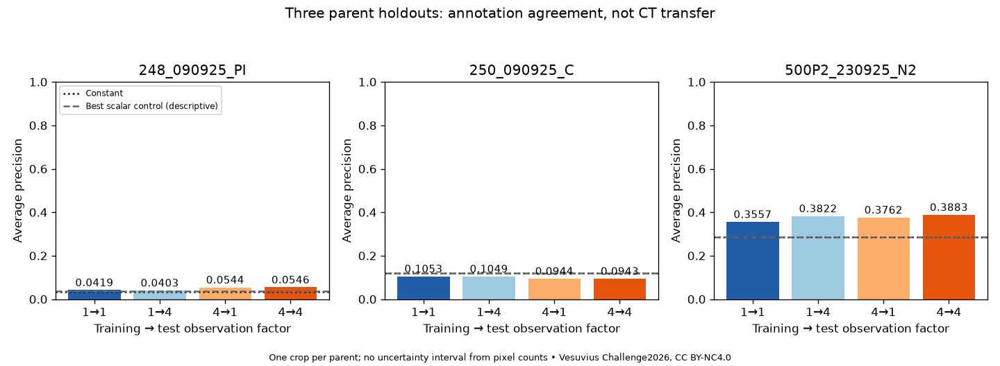
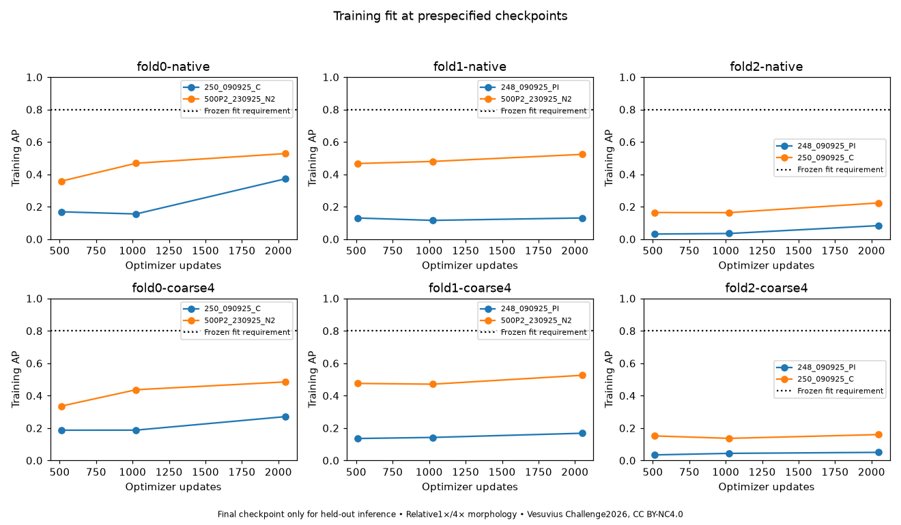

# Experiment 44 — measured profilometry and a CPU resolution control

**Decision: NATIVE_POSITIVE_CONTROL_NOT_FIT__RESOLUTION_CONCLUSION_INCONCLUSIVE.** Complete six-arm comparison; no model promoted, no teacher or GPU arm admitted. The native positive-control fit requirement was not met. This does not establish information loss under 4× degradation, absence of recoverable signal, or failure of the published method.

The official release supplied a usable, qualified optical-annotation comparison. Its raw-height coordinate matrices, normalized heights, brightfield and labels could be joined on the same fixed grids. The scientific outcome is narrower than file integrity: agreement with these manual optical labels is not independent chemical ink truth, CT transfer or a new reading.

## Held-out results

Train→test denotes the relative observation factor. All four predictions use exactly the same measured support per parent.

| Held-out papyrus |1→1 AP|1→4 AP|4→1 AP|4→4 AP|Constant AP|
|---|---:|---:|---:|---:|---:|
|248_090925_PI|0.041889|0.040262|0.054394|0.054633|0.032787|
|250_090925_C|0.105321|0.104876|0.094367|0.094288|0.119569|
|500P2_230925_N2|0.355715|0.382227|0.376151|0.388310|0.284576|
|Equal-parent mean|0.167642|0.175788|0.174971|0.179077|0.145644|

Native–native minus coarse–coarse macro AP: **-0.011435**. Coarse-trained minus native-trained AP on coarse input: **+0.003289**. These descriptive differences do not override the failed native-fit gate. `LEARNING_ANALYSIS.json` retains every AP/AUROC/Dice/Brier result, all scalar controls and regional gates.

There are only three physical groups, one label-enriched crop per group. No pixel bootstrap, significance claim or general-population prevalence estimate is appropriate. All three crops are now reference-review and development exposed. The model initialization is paired within each fold; this is not a multi-seed robustness study.

## Native training fit and the budget question

|Native fold|Training papyrus|AP at 2,048|Change from 1,024|
|---|---|---:|---:|
|fold0-native|250_090925_C|0.372165|+0.216947|
|fold0-native|500P2_230925_N2|0.527950|+0.059739|
|fold1-native|248_090925_PI|0.130507|+0.014939|
|fold1-native|500P2_230925_N2|0.522920|+0.043479|
|fold2-native|248_090925_PI|0.083207|+0.048636|
|fold2-native|250_090925_C|0.223273|+0.059749|

The frozen fit requirement was AP ≥ 0.80 on each training parent. At least one native training AP continued improving by ≥ 0.01 in the last half of the budget. Therefore 2,048 updates did not establish convergence. The result leaves optimization budget and representation/objective adequacy unresolved; it is not evidence that better observations contain no useful information. A successful native fit would still need the prespecified held-out control margins before a resolution interpretation.

The 29,937-parameter, 192-pixel-context U-Net is a small CPU baseline. It is not a replication of the source paper’s larger nnU-Net/SGD/Dice-plus-cross-entropy training recipe. The native and coarse arms had identical initialization, capacity, sampling, common support, augmentation and 2,048-update budgets; six runs total 12,288 optimizer updates. Final checkpoints only were evaluated on held-out parents.

## Objective caveat

Replaying the frozen label/support draws showed that foreground-centered sampling and natural-prevalence BCE weighting both emphasize positives. The optimal constant sigmoid under that sampled, weighted objective is 0.82–0.89. Consequently fixed 0.5 predictions, Dice and Brier are not calibrated natural-prevalence segmentation results. The original metrics remain reported; no threshold or objective was changed after outputs. Calibration by itself would not improve ranking AP. See `SAMPLING_AUDIT.json` and `FIXED_THRESHOLD_DIAGNOSTIC.json`.

## Actual-file and reference checks

Pinned source: `scrollprize/profilometer` revision `a806bead2f3b9100c20e19de37814fb285cfeefd`. Four files for each of 14 regions were accounted for. Folds 5–7 are disjoint, exhaustive leave-one-papyrus-out splits; folds 0–4 mix parents. We selected the smallest region per parent before image inspection, then one 1536² label-enriched crop using a frozen central-grid rule. No failed crop was replaced.

Acquisition used **94 HTTP responses including redirects**, **277,206,869 delivered bytes**. Header stage: 46 responses/1,207,830 bytes. Pixel stage: 48 responses/275,999,039 bytes, below its 384 MiB cap. No HTTP failures or automatic retries. Ranges cover full-width strips/rows needed for the crops; whole raw-height files or complete scan volumes were not downloaded. The three full small PNG labels passed their published LFS SHA-256 digests. Other artifacts have verified range hashes and resolver identities, not a claimed whole-file digest.

|Region|Finite raw height|Common QC support|Raw→normalized 99th-percentile absolute residual|
|---|---:|---:|---:|
|248_090925_PI|99.291%|94.909%|0.49483 uint16 level|
|250_090925_C|99.343%|95.417%|0.49492 uint16 level|
|500P2_230925_N2|97.977%|93.238%|0.49531 uint16 level|

The final model support additionally excludes invalid bilinear interpolation neighborhoods and 32-pixel borders. It contains 6,166,280 pixels, including 888,112 source foreground pixels. Raw NaNs remain measurement-invalid; nearest-filled context never becomes an observed target. Source zero labels mean annotation-negative, not chemically proven non-ink. The separately reviewed images show textured papyrus rather than a large exterior-air background; small defects and manual-boundary uncertainty remain.

TIFF directories reside at file ends. Six head-only directory failures were resolved with tail ranges. Raw matrices contain a trailing empty semicolon field, which the corrected parser removes without dropping interior missing values. The brightfield TIFFs have 8-bit channels but declare IEEE floating samples; we retained the originals and explicitly interpreted those bytes as RGB8 for visual review. No source file was repaired silently. Raw height, not this display interpretation or the inpainted TIFF, supplies learning input.

The source full labels and documented nonzero rule resolve the crop-only polarity ambiguity: white denotes the named letters. Review is qualified annotation agreement, not independent expert registration or chemical authentication. See `REFERENCE_ADMISSION.json`, `IMPLEMENTATION_REVIEW.md` and the three review figures.

The lateral sampling discrepancy remains open: 0.68793625 µm/pixel in metadata versus 0.34 µm in the paper. All claims here use relative 1×/4× factors. No physical resolution cutoff, isotropic Z-binning claim or correspondence to CT is inferred.

## Verification and reproducibility

Eleven learning-contract check groups passed before the training GO, including independent degradation coordinates, missing-neighborhood support, tied AP/AUROC arithmetic and paired initialization/minibatches. A separate raw text parser reconstructed all 7,077,888 acquired crop height values. Post-run verification reconstructed 12 held-out score-map metrics, 18 training-fitted scalar controls, and replayed 12 final training predictions from checkpoints: 294 metric fields agreed. Verification added 216 inference batches and zero optimizer updates. There were no scientific training retries.

The retained selected Git export includes code, protocols, receipts, metrics and compact figures. Bulk crop arrays, ranges, scores and checkpoints remain local. A tested recovery tool reconstructs the nine original input arrays from six pinned public ranges; its cached-range test passed byte-for-byte, but fresh-machine/network replay and full training replay were not performed. See `PORTABILITY.md`. The historical experiment 39 capsule is unchanged.

## Next recommendation

Run one **native-only budget continuation check** before a teacher or another resolution comparison. Use the first native fold, preserve its inputs, objective, 192-pixel context and seed, and replay to 2,048 updates to verify exact checkpoint equality while recovering optimizer state. Continue that same trajectory to 4,096 and 8,192, saving optimizer state and training-fit checkpoints. Do not change loss/calibration/architecture at the same time. Stop immediately for integrity/nonfinite failure; otherwise use the 8,192 endpoint. Training AP ≥ 0.80 on both training papyri would justify completing native qualification across all parents. Failure with < 0.01 AP improvement on both in the last interval would redirect effort toward representation/context or objective design. Continued material improvement below the fit gate remains budget-inconclusive, not an information-loss result. Do not use another held-out score to choose the endpoint.

This recommendation isolates budget while preserving the documented objective caveat. It is a proposal, not a new training GO or a started run. In parallel, the coordinate-linked CT reference remains necessary for the main research objective; the Paris4 request is still unsent. The stopped Paris4 panel and historical full-depth contract are unchanged.

GPU spend for this study: **£0**. No GPU job, R2 write, maintainer message, transcript or translation. The £10 total first-GPU-pilot cap remains, and GPU work stays deferred.

Data and derivative figures: Vesuvius Challenge (2026), *Optical profilometry of opened Herculaneum papyri*, https://doi.org/10.1038/s41598-026-58467-1. CC BY-NC 4.0; exact source license retained under `source-evidence/LICENSE.md`.
