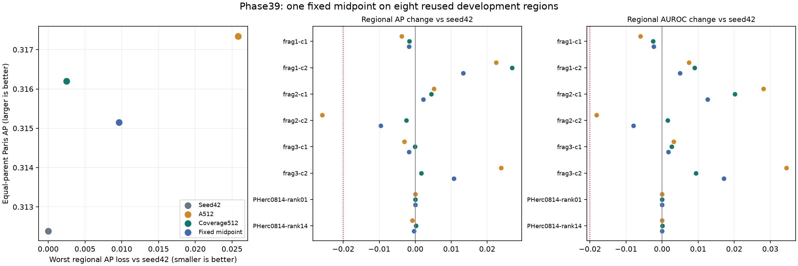

# Phase39 results: fixed midpoint does not match the coverage tradeoff

The fixed midpoint passes the eight-region retention limit but fails the AP advancement gate. Coverage512 has higher equal-parent Paris AP and smaller worst AP and AUROC losses than this midpoint. Retain seed42 and defer GPU work. The next useful trained study is a single preselected disjoint PHerc1667 region replication under the same matched total class-exposure design; no such run is included here.

## Frozen comparison and results

Exactly one midpoint was formed from retained FP32 seed42 and A512 score maps using float64 arithmetic: `0.5*seed42 + 0.5*A512`. The coefficient was proposed before this analysis; GO froze 88 input/code pins before its outputs. This is a post-result comparison relative to phase38 and a prediction comparator, not a trained checkpoint or proof of equivalence to fewer updates. No new model execution or training occurred.

| Role | Paris AP | Paris AUROC | Worst regional AP delta | Worst regional AUROC delta |
| --- | ---: | ---: | ---: | ---: |
| Seed42 | 0.312384168 | 0.721214951 | +0.000000000 | +0.000000000 |
| A512 | 0.317344041 | 0.732029923 | -0.025821085 | -0.018205357 |
| Coverage512 | 0.316197413 | 0.727732786 | -0.002464336 | -0.002522211 |
| Fixed midpoint | 0.315146551 | 0.726847859 | -0.009638093 | -0.007936155 |

Worst deltas are the minima across all eight regions against seed42. Paris summaries give equal weight to the two Paris parents, averaging regions within each parent; PHerc0814 contributes to retention, not that aggregate.

Midpoint AP increases by 0.002762383 against seed42 and is 0.002197490 below A512. Both gains fail the frozen +0.01 requirement; no midpoint region breaches the -0.02 AP/AUROC floor. The separate descriptive relation fails all three components: midpoint AP is 0.001050862 below coverage512, its worst AP delta is 0.007173757 lower, and its worst AUROC delta is 0.005413945 lower.

## All regional comparisons

Every entry below is a delta against seed42. Full raw metrics for all four roles, all regional deltas, fixed-threshold diagnostics and reference reproduction are in [METRICS.json](run-v1/METRICS.json).

| Region | Midpoint AP delta | Coverage AP delta | Midpoint AUROC delta | Coverage AUROC delta |
| --- | ---: | ---: | ---: | ---: |
| frag1-context1 | -0.001740729 | -0.001610913 | -0.002314955 | -0.002522211 |
| frag1-context2 | +0.013308240 | +0.026928006 | +0.004915979 | +0.008970978 |
| frag2-context1 | +0.002203195 | +0.004399013 | +0.012562233 | +0.020126970 |
| frag2-context2 | -0.009638093 | -0.002464336 | -0.007936155 | +0.001532985 |
| frag3-context1 | -0.001751320 | -0.000072753 | +0.001766822 | +0.002632842 |
| frag3-context2 | +0.010734545 | +0.001699848 | +0.017151259 | +0.009384135 |
| pherc0814-46527-fresh-rank01 | -0.000002461 | -0.000013375 | -0.000001438 | -0.000008773 |
| pherc0814-46527-fresh-rank14 | -0.000334771 | +0.000226279 | -0.000026841 | +0.000064842 |

Coverage512 is not uniformly better by region: for example, midpoint retains a larger AP improvement on frag3-context2. Its advantage here is the specifically frozen aggregate/worst-region tradeoff. No uncertainty interval or population significance is claimed.

## Verification and interpretation

Four contract fixtures passed, including exact-tie ranking and the half-ULP precision case. The separate verifier reconstructed all eight canonical masks, all 1,179,648 midpoint pixels exactly, 64 AP/AUROC values (maximum discrepancy 1.11e-16), parent aggregates, all reported deltas and both decisions. The three prior references reproduced their retained ranking metrics and threshold counts. One scientific attempt completed; zero retries, neural forwards, optimizer updates, acquisitions or GPU use.

This rejects only one fixed reduction of prediction movement as an explanation sufficient to reproduce this particular coverage tradeoff. It does not rule out other coefficients, fewer updates or stronger preservation objectives; none were searched. The data-diversity mechanism remains confounded because phase38 replaced half the original PHerc0139 patch exposures while matching total positive/negative counts. A disjoint source-region replication would test crop dependence, not remove that confound.

All eight evaluation regions are reused development. Supplied manual-plus-iterative references have incomplete ancestry and are not authenticated independent ink truth. No optical alignment, physical depth, new readable text, transcription or translation has been established. Frag6 registration/depth remain unresolved; full original 17-plane predictions and all reserved parents remain unchanged. CPU cost is not constrained by the user; the £10 total first GPU pilot cap remains and GPU work is deferred.
